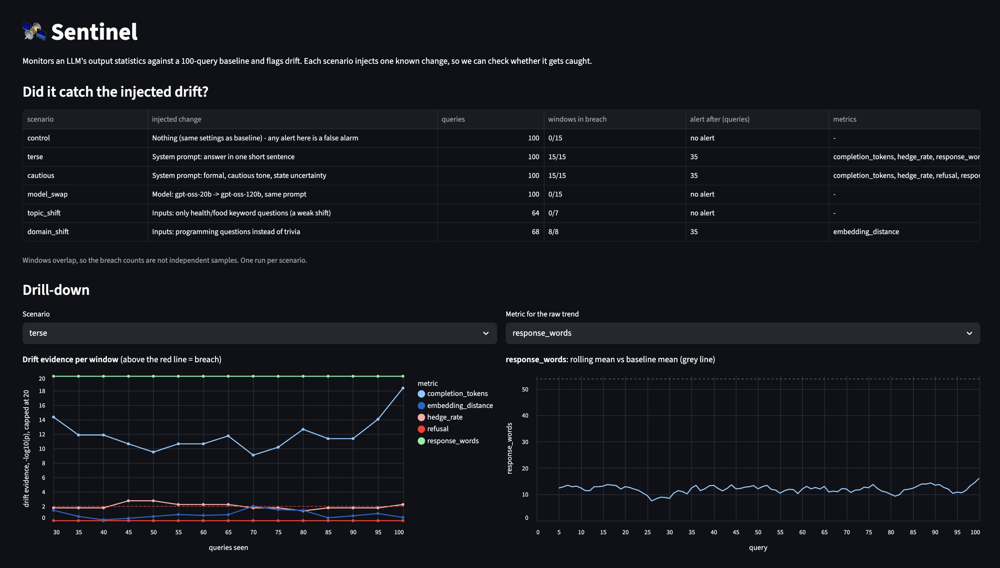

# Sentinel

An LLM output-drift monitor. It records per-response statistics for an LLM, compares sliding windows of recent responses against a 100-query baseline, and raises an alert (Slack) when drift is confirmed. Because real APIs do not drift on demand, drift is **injected on purpose** (changed prompt, changed model, changed inputs) so the detector can be tested against known changes and a no-drift control.

Companion project: [Veritas](https://github.com/Mogulpranav/Veritas) (a multi-agent hallucination-reduction pipeline).

## How it works

```
questions -> monitored LLM call -> per-response metrics -> sliding-window tests vs baseline -> alert
                                          |                                   |
                                  data/runs/*.jsonl                  MLflow runs + Slack + dashboard
```

**Model:** gpt-oss-20b on Groq (gpt-oss-120b for one scenario). **Traffic:** TruthfulQA questions, plus 68 programming questions for the domain-shift scenario. **632 monitored queries** in total.

**Six metrics per response:** word count, completion tokens, latency, refusal flag (regex), hedging-word rate (a crude uncertainty proxy), and the cosine distance of the response embedding (`all-MiniLM-L6-v2`) from the baseline centroid.

**Detection:** a Kolmogorov-Smirnov test per metric (Fisher exact test for the 0/1 refusal flag) between each 30-query window and the baseline. A breach needs p < 0.05 / 5 (Bonferroni over the five alert metrics). An alert is sent after **two consecutive** breaching windows. Latency is logged but not used for alerts (see Findings).

## Scenarios and results



Each scenario injects one change after the baseline (100 queries).

| Scenario | Injected change | Windows in breach | Alert |
|---|---|---|---|
| control | none (same settings as baseline) | 0 / 15 | none (correct) |
| terse | system prompt: one short sentence | 15 / 15 | after 35 queries |
| cautious | system prompt: formal, state uncertainty | 15 / 15 | after 35 queries |
| domain_shift | programming questions instead of trivia | 8 / 8 | after 35 queries |
| topic_shift | only health/food keyword questions (a weak shift) | 0 / 7 | none |
| model_swap | gpt-oss-20b -> gpt-oss-120b, same prompt | 0 / 15 | none |

3 of the 5 injected drifts were detected, with no breaches on the no-drift control. "After 35 queries" is the earliest possible alert with a 30-query window, a 5-query step and 2 required windows; shorter windows were not tested.

**Alert delivery:** across six Slack alerts (two runs), the webhook accepted the message in about 170-235 ms after the breach was confirmed. This is the time to Slack's acknowledgment from a laptop, not the time until a person sees it. The data is replayed from saved runs, so it does not measure time-to-detect in live traffic.

## Findings and limitations

- **Latency is a bad drift signal here.** With latency included, the no-drift control breached in 13 of 15 windows, because Groq response time depends on provider load and time of day, not on the model's output. It is logged but excluded from alerts.
- **The model swap was not detected.** gpt-oss-20b and 120b produce statistically similar outputs on these metrics (word count, tokens, hedging, refusal, embedding distance).
- **topic_shift was a weak test.** TruthfulQA already contains many health and food questions, so the subset barely differs from the baseline. The clearly different domain (programming) was detected.
- **The baseline is not perfectly stable:** its second half runs slightly longer than its first half (p = 0.039 for words, 0.012 for tokens).
- **Windows overlap**, so "0/15" and "15/15" are not independent samples. Each scenario is one run; there are no confidence intervals, and generation uses temperature 0.7.
- The refusal flag and hedging score are simple regex / word-list heuristics. The `cautious` prompt itself makes the model say "I'm not sure", which the refusal regex also counts.

## Run it

```bash
python3 -m venv venv && source venv/bin/activate
pip install -r requirements.txt
echo 'GROQ_API_KEY=your_key' > .env          # optional: SLACK_WEBHOOK_URL=...

python3 src/collect.py --scenario baseline    # also: control, terse, cautious, model_swap, topic_shift, domain_shift
python3 src/analyze.py                        # detection table, writes results/detection.json
python3 src/monitor.py                        # replay + MLflow + alerts
streamlit run dashboard.py                    # dashboard
mlflow ui --backend-store-uri sqlite:///mlflow.db
```

The collected runs are committed in `data/runs/` (metrics and response embeddings only, no response text), so `analyze.py`, `monitor.py` and the dashboard work without calling the API.

## Layout

```
src/metrics.py    per-response metrics
src/collect.py    monitored LLM calls + scenario definitions (resumable)
src/analyze.py    sliding-window drift tests
src/monitor.py    replay, MLflow tracking, Slack/file alerts
dashboard.py      Streamlit dashboard
data/runs/        collected scenario data
results/          detection and alert outputs
```

## Stack

Python, Groq (gpt-oss-20b / 120b), sentence-transformers, SciPy, MLflow, Streamlit.
